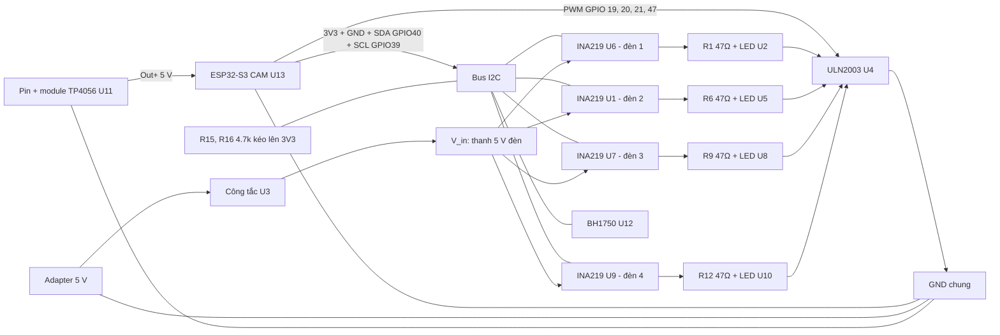

# 03 — Sơ đồ nối dây (Mức 1)

> Cập nhật: 2026-11-18. **Theo schematic EasyEDA** [reference/Schematic_smart_street_light.png](../reference/Schematic_smart_street_light.png)
> (SMART_STREET_LIGHT, REV 1.0, GROUP 15, 2026-09-19). Dựa trên [00](00-project-setup-plan.md), [01](01-ai-models-and-dataset.md), [02](02-linh-kien-can-mua.md)
> và [reference/ina219-module.md](../reference/ina219-module.md).
>
> Board: **Freenove ESP32-S3 WROOM CAM**. Số trong ngoặc `(hdr N)` là **số thứ tự chân trên header** của board (1–40) như ký hiệu U13 trong schematic.
> - **Chân camera:** tài liệu Freenove dùng cấu hình `CAMERA_MODEL_ESP32S3_EYE` → camera chiếm GPIO 4–13, 15–18 (đã xác nhận nguồn).
> - **Chân thẻ SD (38/39/40), LED trên board (2), LED RGB (48):** chưa đối chiếu được, kiểm tra lại trên board trước khi nối.
>
> **Khác với bản trước (2026-09-15):** I2C chuyển sang GPIO 40/39; thêm 2 điện trở kéo lên 4.7 kΩ; R đèn = 47 Ω;
> thêm tụ 100 nF cho từng module; ESP32 cấp 5 V từ module TP4056 thay vì sạc dự phòng USB-C. Xem mục 11 (điểm cần kiểm tra).

## 1. Danh sách thiết bị và các chân dùng tới

| # | Thiết bị (ký hiệu schematic) | SL | Chân dùng |
|---|---|---|---|
| 1 | ESP32-S3 CAM (U13, N16R8 + OV2640) | 1 | 5V (hdr 20), 3V3 (hdr 1), GND (hdr 21), 4 GPIO PWM, 2 GPIO I2C. Camera cắm sẵn trên board. USB-C dùng nạp code |
| 2 | Module TP4056 `DLG_TP4056_DB_PK` (U11) + đầu nối pin P1 (2 chân, bước 5.00) | 1 | Out+ → 5V ESP32, Out− → GND. Bat+/Bat−, In+/In− (schematic để hở) |
| 3 | Adapter 5 V ≥ 1 A + jack DC cái 5.5×2.1 (DC1) | 1 | (+) 5 V, (−) GND |
| 4 | Công tắc gạt 13 mm ON-OFF-ON (U3) | 1 | Chân 1 → V_in, chân 3 ← jack DC, chân 2 để hở |
| 5 | IC ULN2003APG (U4, DIP-16) + đế | 1 | IN1–IN4 (chân 1–4), GND/E (8), OUT1–OUT4 (16–13) |
| 6 | Module INA219 (U6, U1, U7, U9) | 4 | Vcc, Gnd, Scl, Sda, Vin+, Vin− |
| 7 | Module BH1750 (U12, GY-302) | 1 | VCC, GND, SCL, SDA, ADD |
| 8 | LED trắng 5 mm (U2, U5, U8, U10) | 4 | Anode (chân dài, +), cathode (chân ngắn, −) |
| 9 | Điện trở **47 Ω** (R1, R6, R9, R12) | 4 | Nối tiếp với LED |
| 10 | Điện trở **4.7 kΩ** (R15, R16) | 2 | Kéo lên 3.3 V cho SDA, SCL |
| 11 | Tụ hoá 470 µF (C1) + tụ gốm 100 nF (C2) | 1 + 1 | Giữa 5V ESP32 và GND |
| 12 | Tụ hoá 100 µF (C3) | 1 | Sau jack DC, giữa V_in (trước công tắc) và GND |
| 13 | Tụ gốm 100 nF (C4–C8) | 5 | Mỗi INA219 (C4, C5, C6, C7) và BH1750 (C8): giữa VCC và GND, đặt sát module |

## 2. Sơ đồ khối tổng



Ba "thế giới" điện áp trong mạch:

| Nhóm | Điện áp | Nguồn | Gồm |
|---|---|---|---|
| **Logic** | 3.3 V | ESP32 (chân 3V3, lấy từ nguồn 5 V của module TP4056) | ESP32, Vcc của 4 INA219 + BH1750, pull-up I2C, tín hiệu PWM |
| **Đèn** (net `V_in`) | 5 V | Adapter qua công tắc | Vin+/Vin− INA219, điện trở, LED, OUT ULN2003 |
| **5 V ESP32** (net `+5V`) | 5 V | Out+ của module TP4056 | Chân 5V ESP32, C1, C2 |
| **GND** | 0 V | **Chung cho cả ba** | Bắt buộc nối lại với nhau tại 1 điểm |

## 3. Quy ước màu dây

| Màu | Dùng cho |
|---|---|
| 🔴 Đỏ | V_in (+5 V adapter, đèn) |
| 🟤 Nâu / đỏ ngắn | +5 V ESP32 (từ module TP4056) |
| 🟠 Cam | 3.3 V của ESP32 (logic) |
| ⚫ Đen | GND |
| 🟢 Xanh lá | SDA |
| 🟡 Vàng | SCL |
| 🔵 Xanh dương | PWM từ ESP32 → ULN2003 |
| ⚪ Trắng / màu khác | Dây cathode từ LED → ULN2003 (dán nhãn số 1–4) |

## 4. Nguồn và GND

```
Pin Li-ion ─► P1 ─► Bat+/Bat− ┌──────────────────────┐
                              │ Module TP4056 (U11)  │
                              │ Out+ ──────────┐     │         ┌───────────────────────────────┐
                              │ Out− ──┐       │     │         │ ESP32-S3 CAM (U13)            │
                              └────────┼───────┼─────┘         │                               │
                                       │       └──► +5V ───────┤ 5V (hdr 20) ──┬── C1 470 µF ─ GND
                                       │                       │               └── C2 100 nF ─ GND
                                       │                       │ 3V3 (hdr 1) ──────────────────┼──► THANH 3.3 V (cam)
                                       └──► GND ◄──────────────┤ GND (hdr 21) ─────────────────┼──► THANH GND (đen) ◄── ĐIỂM GND CHUNG
                                                               └───────────────────────────────┘                          ▲
                                                                                                                          │
Adapter 5 V (+) ► jack DC (DC1) ──┬── C3 100 µF (+) ─ GND                                                                  │
                                  └──► công tắc (U3) ──► V_in = THANH +5 V ĐÈN (đỏ)                                        │
Adapter 5 V (−) ► jack DC ─────────────────────────────────────────────────────────────────────────────────────────────────┘
```

- **Điểm GND chung:** GND ESP32 (hdr 21), Out− của TP4056, cực (−) adapter, chân 8 ULN2003, Gnd của 4 INA219 và BH1750 **đều về thanh GND**.
- C3 nằm **trước công tắc** (ngay sau jack DC), không nằm sau công tắc như bản trước.
- ⛔ **KHÔNG** nối V_in (5 V đèn) vào chân 5V của ESP32.
- ⛔ **KHÔNG** nối V_in hoặc +5 V ESP32 vào thanh 3.3 V.
- Tụ hoá có cực: **chân dài / phía không có vạch trắng là (+)**. Lắp ngược tụ có thể phồng, nổ.

## 5. Bus I2C (1 ESP32 + 4 INA219 + 1 BH1750)

```
THANH 3.3 V ──┬───────────────┬─────────────── (cấp Vcc cho các module, mỗi module 1 tụ 100 nF xuống GND)
              │               │
          [R16 4.7k]      [R15 4.7k]
              │               │
SDA = GPIO 40 ┴─── (hdr 34)   │
SCL = GPIO 39 ────────────────┴─── (hdr 33)

Mỗi module nối song song: Vcc → 3V3, Gnd → GND, Sda → SDA, Scl → SCL

             INA219 (U6)  INA219 (U1)  INA219 (U7)  INA219 (U9)  BH1750 (U12)
             đèn 1        đèn 2        đèn 3        đèn 4        ADD → GND
             0x40         0x41         0x44         0x45         0x23
```

| Chân module | Nối tới | Ghi chú |
|---|---|---|
| Vcc / VCC | Thanh **3.3 V** | ⛔ Không cấp 5 V (I2C sẽ bị kéo lên 5 V, hỏng ESP32). Mỗi module có 1 tụ 100 nF VCC–GND |
| Gnd / GND | Thanh GND | |
| Sda / SDA | Dây SDA chung = **GPIO 40** | Cả 5 module song song |
| Scl / SCL | Dây SCL chung = **GPIO 39** | Cả 5 module song song |
| BH1750 ADD | GND | Địa chỉ `0x23` |
| R16 4.7 kΩ | SDA ↔ 3.3 V | Pull-up SDA (chỉ 1 bộ cho cả bus) |
| R15 4.7 kΩ | SCL ↔ 3.3 V | Pull-up SCL (chỉ 1 bộ cho cả bus) |

- **Địa chỉ INA219** (hàn pad "I2C Address"): schematic không ghi địa chỉ, giữ quy ước cũ theo số đèn: đèn 1 không hàn `0x40`; đèn 2 hàn A0 `0x41`; đèn 3 hàn A1 `0x44`; đèn 4 hàn cả hai `0x45`.
- Module GY-302 / INA219 thường đã có pull-up sẵn trên module. Cả 5 module song song + 2 điện trở 4.7 kΩ ngoài làm điện trở tương đương nhỏ hơn: nếu đo thấy SDA/SCL lỗi, kiểm tra tổng pull-up.
- Tổng chiều dài dây I2C nên < 50 cm, **đi xa dây V_in**.

## 6. Mạch đèn (4 bóng)

### 6.1 Một bóng (lặp lại cho i = 1..4)

```
V_in (thanh +5 V đèn) ──► Vin+ ┌────────────┐ Vin− ──► R 47 Ω ──► (+) anode
                               │ INA219 #i  │                         LED i
                               └────────────┘                        (−) cathode
                                                                          │
ESP32 GPIO PWM_i ─────────────────────────► INi ┌──────────┐ OUTi ◄──────┘
                                                │ ULN2003  │
                                                └────┬─────┘
                                                  chân 8 (E)
                                                     │
                                                THANH GND
```

Dòng điện của bóng đi theo vòng: **adapter (+) → công tắc → V_in → INA219 → điện trở 47 Ω → LED → ULN2003 → GND → adapter (−)**.
ESP32 chỉ gửi tín hiệu PWM vào IN để "mở/đóng van" ULN2003.

### 6.2 Cả 4 bóng

```
                              V_in (THANH +5 V ĐÈN, đỏ)
        ┌──────────────────┬──────────────────┬──────────────────┐
      Vin+               Vin+               Vin+               Vin+
   [INA219 U6]        [INA219 U1]        [INA219 U7]        [INA219 U9]
      Vin−               Vin−               Vin−               Vin−
        │                  │                  │                  │
   R1 47 Ω            R6 47 Ω            R9 47 Ω            R12 47 Ω
        │                  │                  │                  │
   LED U2 (+→−)       LED U5 (+→−)       LED U8 (+→−)       LED U10 (+→−)
        │                  │                  │                  │
   chân 16 (OUT1)     chân 15 (OUT2)     chân 14 (OUT3)     chân 13 (OUT4)
        └──────────────────┴────── ULN2003 (U4) ┴──────────────────┘
                                   chân 8 → THANH GND
```

| Đèn | GPIO PWM | ULN2003 IN → OUT | INA219 | R | LED |
|---|---|---|---|---|---|
| 1 | 19 (hdr 22) | chân 1 → 16 | U6 | R1 | U2 |
| 2 | 20 (hdr 23) | chân 2 → 15 | U1 | R6 | U5 |
| 3 | 21 (hdr 24) | chân 3 → 14 | U7 | R9 | U8 |
| 4 | 47 (hdr 25) | chân 4 → 13 | U9 | R12 | U10 |

### 6.3 Nối chân ULN2003 (U4)

```
                 ┌───┬─┬───┐
 GPIO 19 ────► 1 ┤1B └─┘ 1C├ 16 ◄── cathode LED 1 (U2)
 GPIO 20 ────► 2 ┤2B     2C├ 15 ◄── cathode LED 2 (U5)
 GPIO 21 ────► 3 ┤3B     3C├ 14 ◄── cathode LED 3 (U8)
 GPIO 47 ────► 4 ┤4B     4C├ 13 ◄── cathode LED 4 (U10)
 (để trống)    5 ┤5B     5C├ 12     (để trống)
 (để trống)    6 ┤6B     6C├ 11     (để trống)
 (để trống)    7 ┤7B     7C├ 10     (để trống)
      GND ───► 8 ┤E     COM├ 9      (để trống)
                 └──────────┘
```

| Chân ULN2003 | Nối tới |
|---|---|
| 1, 2, 3, 4 (1B–4B) | GPIO 19, 20, 21, 47 của ESP32 (không cần điện trở) |
| 5, 6, 7 (5B–7B) | **Để trống theo schematic** (nên nối GND cho chắc, xem mục 11) |
| 8 (E) | Thanh GND |
| 9 (COM) | Để trống (LED không cần diode chống ngược) |
| 16, 15, 14, 13 (1C–4C) | Cathode LED 1–4 |
| 12, 11, 10 (5C–7C) | Để trống |

## 7. Gán chân ESP32 (Freenove ESP32-S3 WROOM CAM)

**Các chân KHÔNG được dùng:**

| Chân | Lý do |
|---|---|
| GPIO 4, 5, 6, 7, 8, 9, 10, 11, 12, 13, 15, 16, 17, 18 | Camera OV2640 (`CAMERA_MODEL_ESP32S3_EYE`: SIOD 4, SIOC 5, VSYNC 6, HREF 7, D0–D7 = 11, 9, 8, 10, 12, 18, 17, 16, PCLK 13, XCLK 15) |
| GPIO 35, 36, 37 | PSRAM octal (N16R8) |
| GPIO 19, 20 | USB D−/D+. **Ngoại lệ:** dùng cho đèn 1, 2 (schematic), nên cổng USB native bị tắt khi firmware chạy: nạp/monitor qua cổng COM (UART) |
| GPIO 0, 3, 45, 46 | Chân strapping (ảnh hưởng chế độ khởi động) |
| GPIO 2 | LED trên board (một số phiên bản) |
| GPIO 38 | Khe thẻ nhớ SD (CMD) |
| GPIO 39, 40 | Khe thẻ nhớ SD (CLK, D0). **Ngoại lệ:** schematic dùng làm I2C SCL/SDA, xem mục 11 |
| GPIO 48 | LED RGB trên board (một số phiên bản) |

**Gán chân theo schematic:**

| Chức năng | GPIO | Chân header | Nối tới |
|---|---|---|---|
| PWM đèn 1 | GPIO 19 | hdr 22 | ULN2003 chân 1 |
| PWM đèn 2 | GPIO 20 | hdr 23 | ULN2003 chân 2 |
| PWM đèn 3 | GPIO 21 | hdr 24 | ULN2003 chân 3 |
| PWM đèn 4 | GPIO 47 | hdr 25 | ULN2003 chân 4 |
| I2C **SDA** | **GPIO 40** | hdr 34 | SDA của 4 INA219 + BH1750 (+ R16 4.7 kΩ lên 3V3) |
| I2C **SCL** | **GPIO 39** | hdr 33 | SCL của 4 INA219 + BH1750 (+ R15 4.7 kΩ lên 3V3) |
| 3V3 | — | hdr 1 | Thanh 3.3 V |
| 5V | — | hdr 20 | Out+ module TP4056 (+ C1, C2) |
| GND | — | hdr 21 | Thanh GND |

- Camera dùng bus SCCB riêng (GPIO 4/5). **Bus I2C của cảm biến dùng cổng I2C còn lại**, không nối chung với chân camera.
- Nếu board thật không còn đủ 4 chân PWM → dùng **PCA9685**: nối vào cùng bus I2C (3.3 V, GND, SDA, SCL), 4 kênh PWM của PCA9685 thay cho 4 GPIO.

## 8. Bảng nối dây (tick khi lắp)

| # | Từ | Đến | Màu dây | ✓ |
|---|---|---|---|---|
| **Nguồn** | | | | |
| 1 | Module TP4056 Out+ | ESP32 5V (hdr 20) | đỏ ngắn | ☐ |
| 2 | ESP32 5V | Tụ 470 µF C1 (+) và tụ 100 nF C2 | đỏ ngắn | ☐ |
| 3 | C1 (−), C2 | ESP32 GND (hdr 21) | đen ngắn | ☐ |
| 4 | Module TP4056 Out− | Thanh GND | đen | ☐ |
| 5 | Pin Li-ion | Bat+/Bat− của TP4056 (qua P1), đúng cực | theo cực | ☐ |
| 6 | ESP32 3V3 (hdr 1) | Thanh 3.3 V | cam | ☐ |
| 7 | ESP32 GND (hdr 21) | Thanh GND | đen | ☐ |
| 8 | Adapter (+) (qua jack DC) | Công tắc chân 3 và C3 (+) | đỏ | ☐ |
| 9 | Công tắc chân 1 | V_in (thanh +5 V đèn) | đỏ | ☐ |
| 10 | Adapter (−) (qua jack DC) | Thanh GND và C3 (−) | đen | ☐ |
| **Bus I2C** | | | | |
| 11 | Thanh 3.3 V | Vcc INA219 ×4, VCC BH1750 (mỗi module 1 tụ 100 nF VCC–GND) | cam | ☐ |
| 12 | Thanh GND | Gnd INA219 ×4, GND BH1750 | đen | ☐ |
| 13 | ESP32 GPIO 40 (SDA, hdr 34) | Sda INA219 ×4, SDA BH1750 | xanh lá | ☐ |
| 14 | ESP32 GPIO 39 (SCL, hdr 33) | Scl INA219 ×4, SCL BH1750 | vàng | ☐ |
| 15 | BH1750 ADD | Thanh GND | đen | ☐ |
| 16 | R16 4.7 kΩ | SDA ↔ Thanh 3.3 V | cam | ☐ |
| 17 | R15 4.7 kΩ | SCL ↔ Thanh 3.3 V | cam | ☐ |
| **ULN2003** | | | | |
| 18 | ULN2003 chân 8 (E) | Thanh GND | đen | ☐ |
| 19 | ESP32 GPIO 19 (đèn 1, hdr 22) | ULN2003 chân 1 | xanh dương | ☐ |
| 20 | ESP32 GPIO 20 (đèn 2, hdr 23) | ULN2003 chân 2 | xanh dương | ☐ |
| 21 | ESP32 GPIO 21 (đèn 3, hdr 24) | ULN2003 chân 3 | xanh dương | ☐ |
| 22 | ESP32 GPIO 47 (đèn 4, hdr 25) | ULN2003 chân 4 | xanh dương | ☐ |
| **Bóng 1** | | | | |
| 23 | V_in | INA219 U6 Vin+ | đỏ | ☐ |
| 24 | INA219 U6 Vin− | R1 47 Ω | đỏ | ☐ |
| 25 | R1 | LED U2 anode (+, chân dài) | đỏ | ☐ |
| 26 | LED U2 cathode (−, chân ngắn) | ULN2003 chân 16 | trắng, nhãn "1" | ☐ |
| **Bóng 2** | | | | |
| 27 | V_in | INA219 U1 Vin+ | đỏ | ☐ |
| 28 | INA219 U1 Vin− | R6 47 Ω | đỏ | ☐ |
| 29 | R6 | LED U5 anode | đỏ | ☐ |
| 30 | LED U5 cathode | ULN2003 chân 15 | trắng, nhãn "2" | ☐ |
| **Bóng 3** | | | | |
| 31 | V_in | INA219 U7 Vin+ | đỏ | ☐ |
| 32 | INA219 U7 Vin− | R9 47 Ω | đỏ | ☐ |
| 33 | R9 | LED U8 anode | đỏ | ☐ |
| 34 | LED U8 cathode | ULN2003 chân 14 | trắng, nhãn "3" | ☐ |
| **Bóng 4** | | | | |
| 35 | V_in | INA219 U9 Vin+ | đỏ | ☐ |
| 36 | INA219 U9 Vin− | R12 47 Ω | đỏ | ☐ |
| 37 | R12 | LED U10 anode | đỏ | ☐ |
| 38 | LED U10 cathode | ULN2003 chân 13 | trắng, nhãn "4" | ☐ |

## 9. Thứ tự lắp và kiểm tra

Lắp **từng phần, kiểm tra xong mới lắp tiếp**. Mỗi bước nếu sai thì biết ngay lỗi nằm ở đâu.

| Bước | Lắp | Kiểm tra trước khi đi tiếp |
|---|---|---|
| 1 | Chỉ ESP32 + nguồn 5 V (dây 1–7; khi chưa có module TP4056 có thể tạm cấp qua USB-C) | Nạp chương trình blink/hello, ESP32 chạy ổn |
| 2 | Adapter + công tắc + V_in + C3 (dây 8–10), **chưa nối gì khác** | Đo V_in ↔ GND ≈ 5 V khi gạt ON; **đo thông mạch GND ESP32 ↔ adapter (−)** có bíp |
| 3 | ULN2003 (dây 18) + **1 bóng không qua INA219** (V_in → R1 → LED U2 → chân 16) | Dùng dây nối tạm chân 1 ULN2003 lên 3.3 V → LED sáng; nối xuống GND → tắt |
| 4 | Dây PWM 1 (dây 19) | Chạy PWM 20% / 100% → độ sáng đổi đúng |
| 5 | BH1750 vào bus I2C (dây 11–17, chỉ BH1750) | Quét I2C thấy `0x23`, đọc được lux |
| 6 | INA219 đèn 1 vào bus I2C, chèn vào bóng 1 (dây 23–26) | Quét thấy `0x40`; dòng INA219 khớp đồng hồ vạn năng |
| 7 | Lặp bước 3–6 cho bóng 2, 3, 4 | Quét thấy `0x23, 0x40, 0x41, 0x44, 0x45`; 4 đèn điều khiển riêng được |
| 8 | Chạy tất cả cùng lúc | Đèn không nhấp nháy bất thường, ESP32 không reset, số đo INA219 ổn định |

## 10. Những điều cấm và lỗi hay gặp

| ⛔ Cấm / lỗi | Hậu quả |
|---|---|
| Nối V_in (5 V adapter) vào chân 5V ESP32 | Hai nguồn đẩy dòng vào nhau, có thể hỏng module nguồn/adapter/board |
| Cấp 5 V cho Vcc của INA219 / BH1750 | Chân I2C bị kéo lên 5 V → hỏng GPIO ESP32 |
| Quên nối GND ESP32 với GND adapter | Đèn không bật hoặc chập chờn; INA219 đo sai điện áp |
| Nối LED từ OUT ULN2003 xuống GND | Đèn không bao giờ sáng (ULN2003 chỉ kéo xuống GND) |
| Thiếu điện trở hạn dòng | LED cháy |
| Dùng 1 điện trở chung cho 4 LED | Đèn sáng không đều, bật thêm đèn thì đèn khác tối đi |
| Đảo Vin+ / Vin− INA219 | Dòng đọc ra số âm |
| 2 INA219 trùng địa chỉ | Đọc sai / không đọc được — kiểm tra pad A0/A1 |
| Cắm ngược ULN2003 hoặc tụ hoá | IC nóng/hỏng; tụ phồng/nổ |
| Dùng chân camera / PSRAM / strapping cho PWM, I2C | Camera lỗi, board không khởi động |
| Đảo SDA/SCL (GPIO 40 ↔ 39) | Quét I2C không thấy thiết bị nào |
| Cấp điện khi đang cắm/rút dây | Dễ chập — **luôn tắt công tắc và ngắt nguồn trước khi sửa dây** |

## 11. Điểm cần kiểm tra (phát hiện khi đối chiếu schematic)

| # | Vấn đề | Việc nên làm |
|---|---|---|
| 1 | **Dây thật đảo SDA/SCL so với schematic**: mạch đang nối **SDA = GPIO 39 (hdr 33), SCL = GPIO 40 (hdr 34)**, schematic ghi SDA = 40, SCL = 39 | **Đã xử lý (2026-11-19):** `app_config.h` của `firmware/streetlight-node` và `streetlight-wifi` đặt theo dây thật 39/40 (trước đó là 41/42, quét I2C không thấy thiết bị). Sửa lại schematic cho khớp nếu vẽ lại |
| 2 | **Trùng chân SD**: GPIO 39 (CLK) và 40 (D0) là chân thẻ SD, project [thu_dataset](../thu_dataset/main/app_config.h) đang dùng SD qua 38/39/40 | Khi chạy thu_dataset, rút dây SDA/SCL (hoặc 2 điện trở kéo lên) ra khỏi 39/40; hoặc đổi I2C sang chân khác (vd 41/42) |
| 3 | **Công tắc ON-OFF-ON** 3 chân: schematic nối chân 1 và 3, chân 2 (giữa) để hở. Công tắc SPDT thường có chân **giữa là chung** — khi đó chân 1 và 3 không bao giờ thông nhau | Đo thông mạch bằng đồng hồ trước khi lắp; nếu chân giữa là chung thì nối chân giữa + 1 chân ngoài |
| 4 | **Module TP4056**: schematic chỉ nối Out+ / Out−; In+/In−, Bat+/Bat−, P1 để hở, chưa rõ cực P1 | Đối chiếu datasheet module (chân sạc vào, pin, Out+ có phải 5 V đã qua mạch tăng áp không) trước khi cấp điện |
| 5 | **Cấp nguồn kép cho ESP32**: vừa USB-C (nạp code) vừa Out+ vào chân 5V | Khi cắm USB để nạp code nên ngắt module TP4056, hoặc kiểm tra board có diode chặn ngược ở chân 5V |
| 6 | **Dòng LED**: R = 47 Ω ở 5 V cho khoảng 40 mA/LED (Vf trắng ≈ 3.0–3.2 V), cao hơn mức 20 mA của LED 5 mm thông thường | Xem datasheet LED; nếu giới hạn 20 mA thì dùng R ≥ 100 Ω hoặc giới hạn duty PWM |
| 7 | **ULN2003 IN5–IN7 để hở**: bản trước nối GND | Nên nối GND cho chắc (không ảnh hưởng chức năng) |
| 8 | **Địa chỉ INA219** không có trong schematic | Giữ `0x40/0x41/0x44/0x45` theo đèn 1–4 và khớp `app_config.h` |
