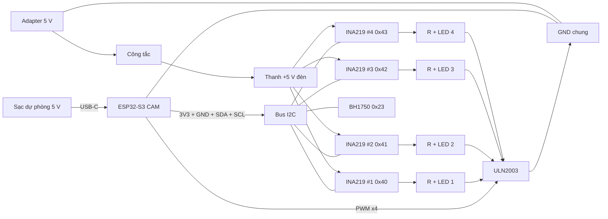

# 03 — Sơ đồ nối dây (Mức 1)

> Cập nhật: 2026-09-15. Dựa trên [00](00-project-setup-plan.md), [01](01-ai-models-and-dataset.md), [02](02-linh-kien-can-mua.md)
> và [reference/ina219-module.md](../reference/ina219-module.md).
>
> Board: **Freenove ESP32-S3 WROOM** (người dùng đã gửi ảnh pinout, nhưng ảnh độ phân giải thấp, không đọc được số chân).
> - **Chân camera:** tài liệu Freenove dùng cấu hình `CAMERA_MODEL_ESP32S3_EYE` → camera chiếm GPIO 4–13, 15–18 (đã xác nhận nguồn).
> - **Chân thẻ SD (38/39/40), LED trên board (2), LED RGB (48):** chưa đối chiếu được, **kiểm tra lại trên ảnh pinout rõ nét hoặc chữ in trên board** trước khi nối.

## 1. Danh sách thiết bị và các chân dùng tới

| # | Thiết bị | SL | Chân dùng |
|---|---|---|---|
| 1 | ESP32-S3 CAM (N16R8 + OV2640) | 1 | USB-C (nguồn + nạp code), 3V3, GND, 4 GPIO PWM, 2 GPIO I2C (SDA, SCL). Camera cắm sẵn trên board |
| 2 | Sạc dự phòng 5 V ≥ 2 A | 1 | Cổng USB ra → cáp USB-C |
| 3 | Adapter 5 V ≥ 1 A + jack DC cái 5.5×2.1 | 1 | (+) 5 V, (−) GND |
| 4 | Công tắc gạt | 1 | 2 chân, nằm trên dây (+) 5 V của adapter |
| 5 | IC ULN2003A (DIP-16) + đế | 1 | IN1–IN4 (chân 1–4), IN5–IN7 (5–7), GND (8), COM (9), OUT1–OUT4 (16–13) |
| 6 | Module INA219 | 4 | Vcc, Gnd, Scl, Sda, Vin+, Vin− |
| 7 | Module BH1750 (GY-302) | 1 | VCC, GND, SCL, SDA, ADDR |
| 8 | LED trắng 5 mm | 4 | Anode (chân dài, +), cathode (chân ngắn, −) |
| 9 | Điện trở 56–68 Ω | 4 | 2 chân |
| 10 | Tụ hoá 470 µF 16 V + tụ gốm 100 nF | 1 + 1 | Gần chân nguồn ESP32 |
| 11 | Tụ hoá 100 µF 16 V | 1 | Trên đường 5 V của đèn |

## 2. Sơ đồ khối tổng



Hai "thế giới" điện áp trong mạch:

| Nhóm | Điện áp | Nguồn | Gồm |
|---|---|---|---|
| **Logic** | 3.3 V | ESP32 (lấy từ sạc dự phòng) | ESP32, Vcc của 4 INA219 + BH1750, tín hiệu I2C, tín hiệu PWM |
| **Đèn** | 5 V | Adapter | Vin+/Vin− INA219, điện trở, LED, OUT ULN2003 |
| **GND** | 0 V | **Chung cho cả hai** | Bắt buộc nối lại với nhau tại 1 điểm |

## 3. Quy ước màu dây

| Màu | Dùng cho |
|---|---|
| 🔴 Đỏ | +5 V của adapter (đèn) |
| 🟠 Cam | 3.3 V của ESP32 (logic) |
| ⚫ Đen | GND |
| 🟢 Xanh lá | SDA |
| 🟡 Vàng | SCL |
| 🔵 Xanh dương | PWM từ ESP32 → ULN2003 |
| ⚪ Trắng / màu khác | Dây cathode từ LED → ULN2003 (dán nhãn số 1–4) |

## 4. Nguồn và GND

```
                         ┌───────────────────────────────┐
Sạc dự phòng 5 V ──USB-C─┤ ESP32-S3 CAM                  │
                         │  5V ──┬── tụ 470 µF (+) ── GND│
                         │       └── tụ 100 nF ───── GND │
                         │  3V3 ─────────────────────────┼──► THANH 3.3 V (cam)
                         │  GND ─────────────────────────┼──► THANH GND (đen) ◄── ĐIỂM GND CHUNG
                         └───────────────────────────────┘                          ▲
                                                                                    │
Adapter 5 V (+) ──► công tắc ──► THANH +5 V ĐÈN (đỏ) ──┬── tụ 100 µF (+)            │
                                                       │         (−) ───────────────┤
Adapter 5 V (−) ────────────────────────────────────────────────────────────────────┘
```

- **Điểm GND chung:** GND ESP32, cực (−) adapter, chân 8 ULN2003, Gnd của 4 INA219 và BH1750 **đều về thanh GND**.
- ⛔ **KHÔNG** nối thanh +5 V đèn vào chân 5V của ESP32.
- ⛔ **KHÔNG** nối thanh +5 V đèn vào thanh 3.3 V.
- Tụ hoá có cực: **chân dài / phía không có vạch trắng là (+)**. Lắp ngược tụ có thể phồng, nổ.

## 5. Bus I2C (1 ESP32 + 4 INA219 + 1 BH1750)

```
THANH 3.3 V ──●──────────●──────────●──────────●──────────●
THANH GND ────┼──●───────┼──●───────┼──●───────┼──●───────┼──●
SDA (GPIO) ───┼──┼──●────┼──┼──●────┼──┼──●────┼──┼──●────┼──┼──●
SCL (GPIO) ───┼──┼──┼──●─┼──┼──┼──●─┼──┼──┼──●─┼──┼──┼──●─┼──┼──┼──●
              │  │  │  │ │  │  │  │ │  │  │  │ │  │  │  │ │  │  │  │
             Vcc Gnd Sda Scl ...    ...        ...        VCC GND SDA SCL
             INA219 #1   INA219 #2  INA219 #3  INA219 #4  BH1750
             (0x40)      (0x41)     (0x42)     (0x43)     (0x23, ADDR → GND)
```

| Chân module | Nối tới | Ghi chú |
|---|---|---|
| Vcc / VCC | Thanh **3.3 V** | ⛔ Không cấp 5 V (I2C sẽ bị kéo lên 5 V, hỏng ESP32) |
| Gnd / GND | Thanh GND | |
| Sda / SDA | Dây SDA chung | Cả 5 module song song |
| Scl / SCL | Dây SCL chung | Cả 5 module song song |
| BH1750 ADDR | GND | Địa chỉ `0x23` |

- **Địa chỉ INA219** (hàn pad "I2C Address"): #1 không hàn `0x40`; #2 hàn A0 `0x41`; #3 hàn A1 `0x42`; #4 hàn cả hai `0x43`.
- Tổng chiều dài dây I2C nên < 50 cm, **đi xa dây +5 V đèn**.

## 6. Mạch đèn (4 bóng)

### 6.1 Một bóng (lặp lại cho i = 1..4)

```
THANH +5 V ĐÈN ──► Vin+ ┌────────────┐ Vin− ──► điện trở 56–68 Ω ──► (+) anode
                        │ INA219 #i  │                                LED i
                        └────────────┘                               (−) cathode
                                                                          │
ESP32 GPIO PWM_i ─────────────────────────► INi ┌──────────┐ OUTi ◄──────┘
                                                │ ULN2003  │
                                                └────┬─────┘
                                                  chân 8
                                                     │
                                                THANH GND
```

Dòng điện của bóng đi theo vòng: **adapter (+) → công tắc → INA219 → điện trở → LED → ULN2003 → GND → adapter (−)**.
ESP32 chỉ gửi tín hiệu PWM vào IN để "mở/đóng van" ULN2003.

### 6.2 Cả 4 bóng

```
                         THANH +5 V ĐÈN (đỏ)
        ┌──────────────────┬──────────────────┬──────────────────┐
      Vin+               Vin+               Vin+               Vin+
   [INA219 #1]        [INA219 #2]        [INA219 #3]        [INA219 #4]
      Vin−               Vin−               Vin−               Vin−
        │                  │                  │                  │
       R1                 R2                 R3                 R4
        │                  │                  │                  │
      LED1 (+→−)         LED2 (+→−)         LED3 (+→−)         LED4 (+→−)
        │                  │                  │                  │
   chân 16 (OUT1)     chân 15 (OUT2)     chân 14 (OUT3)     chân 13 (OUT4)
        └──────────────────┴────── ULN2003 ───┴──────────────────┘
                                   chân 8 → THANH GND
```

### 6.3 Nối chân ULN2003

```
                 ┌───┬─┬───┐
 PWM đèn 1 ──► 1 ┤IN1└─┘OUT1├ 16 ◄── cathode LED 1
 PWM đèn 2 ──► 2 ┤IN2   OUT2├ 15 ◄── cathode LED 2
 PWM đèn 3 ──► 3 ┤IN3   OUT3├ 14 ◄── cathode LED 3
 PWM đèn 4 ──► 4 ┤IN4   OUT4├ 13 ◄── cathode LED 4
      GND ───► 5 ┤IN5   OUT5├ 12     (để trống)
      GND ───► 6 ┤IN6   OUT6├ 11     (để trống)
      GND ───► 7 ┤IN7   OUT7├ 10     (để trống)
      GND ───► 8 ┤GND    COM├ 9      (để trống)
                 └──────────┘
```

| Chân ULN2003 | Nối tới |
|---|---|
| 1, 2, 3, 4 (IN1–IN4) | GPIO PWM đèn 1–4 của ESP32 (không cần điện trở) |
| 5, 6, 7 (IN5–IN7) | GND (kênh không dùng) |
| 8 (GND) | Thanh GND |
| 9 (COM) | Để trống (LED không cần diode chống ngược) |
| 16, 15, 14, 13 (OUT1–OUT4) | Cathode LED 1–4 |
| 12, 11, 10 (OUT5–OUT7) | Để trống |

## 7. Gán chân ESP32 (Freenove ESP32-S3 WROOM)

**Các chân KHÔNG được dùng:**

| Chân | Lý do |
|---|---|
| GPIO 4, 5, 6, 7, 8, 9, 10, 11, 12, 13, 15, 16, 17, 18 | Camera OV2640 (`CAMERA_MODEL_ESP32S3_EYE`: SIOD 4, SIOC 5, VSYNC 6, HREF 7, D0–D7 = 11, 9, 8, 10, 12, 18, 17, 16, PCLK 13, XCLK 15) |
| GPIO 35, 36, 37 | PSRAM octal (N16R8) |
| GPIO 19, 20 | USB |
| GPIO 0, 3, 45, 46 | Chân strapping (ảnh hưởng chế độ khởi động) |
| GPIO 2 | LED trên board (một số phiên bản) |
| GPIO 38, 39, 40 | Khe thẻ nhớ SD (nếu board có) |
| GPIO 48 | LED RGB trên board (một số phiên bản) |

**Gợi ý gán chân:**

| Chức năng | GPIO gợi ý | Nối tới |
|---|---|---|
| PWM đèn 1 | GPIO 1 | ULN2003 chân 1 |
| PWM đèn 2 | GPIO 14 | ULN2003 chân 2 |
| PWM đèn 3 | GPIO 21 | ULN2003 chân 3 |
| PWM đèn 4 | GPIO 47 | ULN2003 chân 4 |
| I2C SDA | GPIO 41 | SDA của 4 INA219 + BH1750 |
| I2C SCL | GPIO 42 | SCL của 4 INA219 + BH1750 |

- Camera dùng bus SCCB riêng (GPIO 4/5). **Bus I2C của cảm biến dùng cổng I2C còn lại**, không nối chung với chân camera.
- Nếu board thật không còn đủ 4 chân PWM → dùng **PCA9685**: nối vào cùng bus I2C (3.3 V, GND, SDA, SCL), 4 kênh PWM của PCA9685 thay cho 4 GPIO.

## 8. Bảng nối dây (tick khi lắp)

| # | Từ | Đến | Màu dây | ✓ |
|---|---|---|---|---|
| **Nguồn** | | | | |
| 1 | Sạc dự phòng | Cổng USB-C ESP32 | cáp USB | ☐ |
| 2 | ESP32 5V | Tụ 470 µF (+) và tụ 100 nF | đỏ ngắn | ☐ |
| 3 | Tụ 470 µF (−), tụ 100 nF | ESP32 GND | đen ngắn | ☐ |
| 4 | ESP32 3V3 | Thanh 3.3 V | cam | ☐ |
| 5 | ESP32 GND | Thanh GND | đen | ☐ |
| 6 | Adapter (+) (qua jack DC) | Công tắc | đỏ | ☐ |
| 7 | Công tắc | Thanh +5 V đèn | đỏ | ☐ |
| 8 | Adapter (−) (qua jack DC) | Thanh GND | đen | ☐ |
| 9 | Thanh +5 V đèn | Tụ 100 µF (+) | đỏ ngắn | ☐ |
| 10 | Tụ 100 µF (−) | Thanh GND | đen ngắn | ☐ |
| **Bus I2C** | | | | |
| 11 | Thanh 3.3 V | Vcc INA219 #1, #2, #3, #4, VCC BH1750 | cam | ☐ |
| 12 | Thanh GND | Gnd INA219 #1, #2, #3, #4, GND BH1750 | đen | ☐ |
| 13 | ESP32 GPIO SDA (41) | Sda INA219 #1–#4, SDA BH1750 | xanh lá | ☐ |
| 14 | ESP32 GPIO SCL (42) | Scl INA219 #1–#4, SCL BH1750 | vàng | ☐ |
| 15 | BH1750 ADDR | Thanh GND | đen | ☐ |
| **ULN2003** | | | | |
| 16 | ULN2003 chân 8 | Thanh GND | đen | ☐ |
| 17 | ULN2003 chân 5, 6, 7 | Thanh GND | đen | ☐ |
| 18 | ESP32 GPIO PWM 1 (1) | ULN2003 chân 1 | xanh dương | ☐ |
| 19 | ESP32 GPIO PWM 2 (14) | ULN2003 chân 2 | xanh dương | ☐ |
| 20 | ESP32 GPIO PWM 3 (21) | ULN2003 chân 3 | xanh dương | ☐ |
| 21 | ESP32 GPIO PWM 4 (47) | ULN2003 chân 4 | xanh dương | ☐ |
| **Bóng 1** | | | | |
| 22 | Thanh +5 V đèn | INA219 #1 Vin+ | đỏ | ☐ |
| 23 | INA219 #1 Vin− | Điện trở R1 | đỏ | ☐ |
| 24 | R1 | LED 1 anode (+, chân dài) | đỏ | ☐ |
| 25 | LED 1 cathode (−, chân ngắn) | ULN2003 chân 16 | trắng, nhãn "1" | ☐ |
| **Bóng 2** | | | | |
| 26 | Thanh +5 V đèn | INA219 #2 Vin+ | đỏ | ☐ |
| 27 | INA219 #2 Vin− | Điện trở R2 | đỏ | ☐ |
| 28 | R2 | LED 2 anode | đỏ | ☐ |
| 29 | LED 2 cathode | ULN2003 chân 15 | trắng, nhãn "2" | ☐ |
| **Bóng 3** | | | | |
| 30 | Thanh +5 V đèn | INA219 #3 Vin+ | đỏ | ☐ |
| 31 | INA219 #3 Vin− | Điện trở R3 | đỏ | ☐ |
| 32 | R3 | LED 3 anode | đỏ | ☐ |
| 33 | LED 3 cathode | ULN2003 chân 14 | trắng, nhãn "3" | ☐ |
| **Bóng 4** | | | | |
| 34 | Thanh +5 V đèn | INA219 #4 Vin+ | đỏ | ☐ |
| 35 | INA219 #4 Vin− | Điện trở R4 | đỏ | ☐ |
| 36 | R4 | LED 4 anode | đỏ | ☐ |
| 37 | LED 4 cathode | ULN2003 chân 13 | trắng, nhãn "4" | ☐ |

## 9. Thứ tự lắp và kiểm tra

Lắp **từng phần, kiểm tra xong mới lắp tiếp**. Mỗi bước nếu sai thì biết ngay lỗi nằm ở đâu.

| Bước | Lắp | Kiểm tra trước khi đi tiếp |
|---|---|---|
| 1 | Chỉ ESP32 + sạc dự phòng (dây 1–5) | Nạp chương trình blink/hello, ESP32 chạy ổn |
| 2 | Adapter + công tắc + thanh +5 V + tụ (dây 6–10), **chưa nối gì khác** | Đo thanh +5 V ↔ GND ≈ 5 V; **đo thông mạch GND ESP32 ↔ adapter (−)** có bíp |
| 3 | ULN2003 (dây 16–17) + **1 bóng không qua INA219** (thanh +5 V → R1 → LED1 → chân 16) | Dùng dây nối tạm chân 1 ULN2003 lên 3.3 V → LED sáng; nối xuống GND → tắt |
| 4 | Dây PWM 1 (dây 18) | Chạy PWM 20% / 100% → độ sáng đổi đúng |
| 5 | BH1750 vào bus I2C (dây 11–15, chỉ BH1750) | Quét I2C thấy `0x23`, đọc được lux |
| 6 | INA219 #1 vào bus I2C, chèn vào bóng 1 (dây 22–25) | Quét thấy `0x40`; dòng INA219 khớp đồng hồ vạn năng |
| 7 | Lặp bước 3–6 cho bóng 2, 3, 4 | Quét thấy `0x23, 0x40, 0x41, 0x42, 0x43`; 4 đèn điều khiển riêng được |
| 8 | Chạy tất cả cùng lúc | Đèn không nhấp nháy bất thường, ESP32 không reset, số đo INA219 ổn định |

## 10. Những điều cấm và lỗi hay gặp

| ⛔ Cấm / lỗi | Hậu quả |
|---|---|
| Nối +5 V adapter vào chân 5V ESP32 | Hai nguồn đẩy dòng vào nhau, có thể hỏng sạc/adapter/board |
| Cấp 5 V cho Vcc của INA219 / BH1750 | Chân I2C bị kéo lên 5 V → hỏng GPIO ESP32 |
| Quên nối GND ESP32 với GND adapter | Đèn không bật hoặc chập chờn; INA219 đo sai điện áp |
| Nối LED từ OUT ULN2003 xuống GND | Đèn không bao giờ sáng (ULN2003 chỉ kéo xuống GND) |
| Thiếu điện trở hạn dòng | LED cháy |
| Dùng 1 điện trở chung cho 4 LED | Đèn sáng không đều, bật thêm đèn thì đèn khác tối đi |
| Đảo Vin+ / Vin− INA219 | Dòng đọc ra số âm |
| 2 INA219 trùng địa chỉ | Đọc sai / không đọc được — kiểm tra pad A0/A1 |
| Cắm ngược ULN2003 hoặc tụ hoá | IC nóng/hỏng; tụ phồng/nổ |
| Dùng chân camera / PSRAM / strapping cho PWM, I2C | Camera lỗi, board không khởi động |
| Cấp điện khi đang cắm/rút dây | Dễ chập — **luôn tắt công tắc và rút sạc trước khi sửa dây** |
